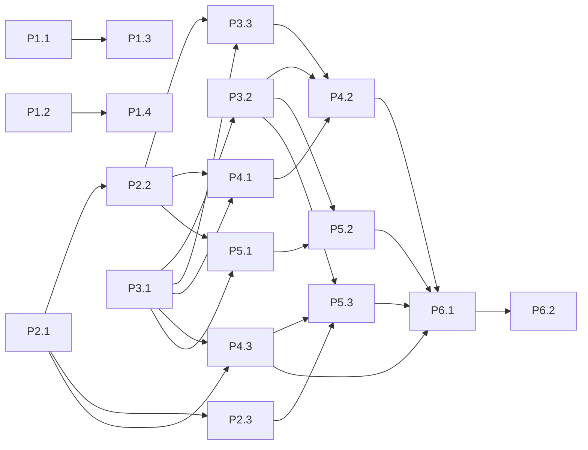
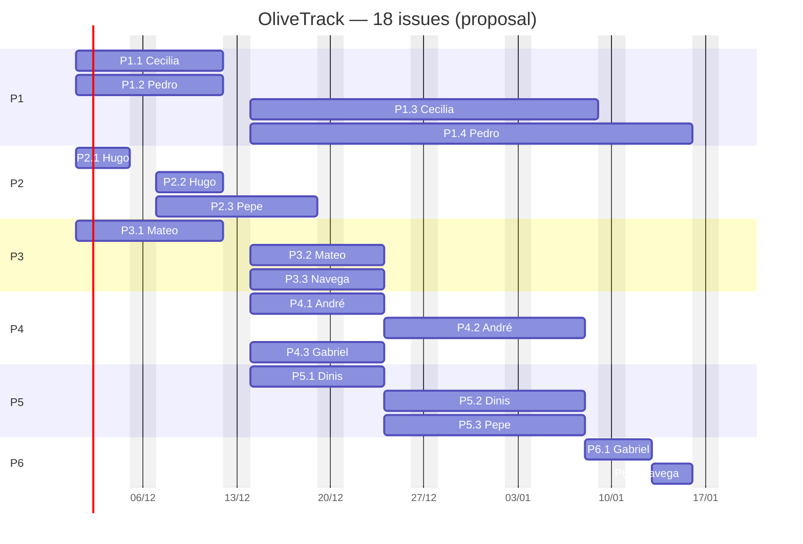

# OliveTrack — Phased Implementation Plan

Working document derived from `docs/report.pdf` (version of 21 November 2026) and the team's phase
allocation. It is the basis for the **18 issues** on GitHub (2 per member) and for the Gantt chart.

---

## 1. How to use this document

- Each issue has a **stable ID** (`P<phase>.<n>`), an owner, dates, dependencies and a list of tasks
  with acceptance criteria, ready to copy to GitHub.
- The **dates are a proposal**, with delivery and defence by **15 January 2027**. Only weekends are
  excluded.
- The allocation of phases to pairs comes from the team. The split **within each pair**, the
  management issues (P1) and the dates are a proposal to be confirmed.
- Page and requirement references (`UC-xx`, `FR-xxx`, `BR-xxx`, `p. N`) point to the report.
- No issue has been completed.

**Suggested labels:** `fase:P1`…`fase:P6`, `plano`.

---

## 2. Phase overview

| Phase | Name | Pair | Issues | Proposed period |
|---|---|---|---|---|
| P1 | Project management documentation | Cecilia and Pedro | 4 | 01/12 – 15/01 |
| P2 | Environment, foundation, shared contracts and calculations | Hugo and Pepe | 3 | 01/12 – 18/12 |
| P3 | Database, seed data and local offline data | Mateo and Navega | 3 | 01/12 – 23/12 |
| P4 | API, synchronisation, access, files, deployment and backups | André and Gabriel | 3 | 14/12 – 07/01 |
| P5 | Agricultural features and screens | Pepe and Dinis | 3 | 14/12 – 07/01 |
| P6 | Integration, testing, validation and final delivery | Gabriel and Navega | 2 | 08/01 – 15/01 |

---

## 3. Allocation by member

| Member | First issue | Second issue |
|---|---|---|
| Cecilia | P1.1 Scope, requirements and client expectations | P1.3 Risks, responsibilities and AI usage inventory |
| Pedro | P1.2 Estimates, schedule and Gantt | P1.4 Progress tracking and final management dossier |
| Hugo | P2.1 Development environment and continuous integration | P2.2 Project foundation: API modules and PWA shell |
| Pepe | P2.3 Shared contracts and calculations | P5.3 Documents and indicators |
| Mateo | P3.1 Data model and core migrations | P3.2 Remaining migrations and data integrity |
| Navega | P3.3 Seed data and local offline storage | P6.2 Client validation, handover and final delivery |
| André | P4.1 Accounts and access control | P4.2 Synchronisation API foundation |
| Gabriel | P4.3 Protected files, deployment and backups | P6.1 Integration and testing |
| Dinis | P5.1 Properties, campaigns, workers and planning | P5.2 Work records and deliveries |

---

## 4. Phase P1 — Project management documentation

**Pair:** Cecilia and Pedro.

### P1.1 — Scope, requirements and client expectations

- **Owner:** Cecilia
- **Dates:** 01/12/2026 → 11/12/2026 (9 working days)
- **Depends on:** —
- **Goal:** Set the scope baseline and how it is changed and validated with the client.

**Tasks:**

- [ ] **Statement of Work and scope** — review included and excluded scope and the single delivery. *Acceptance:* version reviewed by the team, with date.
- [ ] **Change control** — record how requirement changes are proposed, approved and propagated. *Acceptance:* written procedure, applied to the first change.
- [ ] **Client validation** — checkpoints with the intermediary on scope, schedule and quality. *Acceptance:* questions, answers and assumptions recorded.

**Refs:** Sections 3, 3.6, 10.5 and 11.2 of the report.

### P1.2 — Estimates, schedule and Gantt

- **Owner:** Pedro
- **Dates:** 01/12/2026 → 11/12/2026 (9 working days)
- **Depends on:** —
- **Goal:** Reconcile effort and capacity and approve the schedule up to 15 January.

**Tasks:**

- [ ] **Estimates and capacity** — update the workbook and confirm each member's availability. *Acceptance:* remaining effort and capacity recorded per person.
- [ ] **Issues and Gantt** — publish the 18 issues, owners, dependencies and dates on the board. *Acceptance:* Roadmap view reviewed by the team.
- [ ] **Timesheet** — define how actual hours and meeting effort are recorded. *Acceptance:* first week recorded by everyone.

**Refs:** Sections 10.6 and 11.3 (Q-PM-01).

### P1.3 — Risks, responsibilities and AI usage inventory

- **Owner:** Cecilia
- **Dates:** 14/12/2026 → 08/01/2027 (20 working days)
- **Depends on:** P1.1
- **Goal:** Keep the risk register alive and close the open responsibilities.

**Tasks:**

- [ ] **Risk register** — review priority risks weekly, with owner, status, action and due date. *Acceptance:* dated reviews with evidence.
- [ ] **Owners and backups** — name owners for coordination, risk, testing and operations. *Acceptance:* each area has a name and a backup.
- [ ] **AI inventory** — record tools, tasks and who reviewed each contribution. *Acceptance:* complete inventory for the whole team.

**Refs:** Sections 10.3–10.5 and 11.3 (Q-PM-02).

### P1.4 — Progress tracking and final management dossier

- **Owner:** Pedro
- **Dates:** 14/12/2026 → 15/01/2027 (25 working days)
- **Depends on:** P1.2
- **Goal:** Track planned against actual and gather the management documentation for delivery.

**Tasks:**

- [ ] **Weekly tracking** — compare planned and actual dates, hours and remaining effort. *Acceptance:* one record per week, with deviations and decisions.
- [ ] **Final dossier** — gather plan, estimates, hours, risks, decisions and lessons learned. *Acceptance:* shared folder complete before the defence.

**Refs:** Sections 1.4 and 10.6.

---

## 5. Phase P2 — Environment, foundation, shared contracts and calculations

**Pair:** Hugo and Pepe.

### P2.1 — Development environment and continuous integration

- **Owner:** Hugo
- **Dates:** 01/12/2026 → 04/12/2026 (4 working days)
- **Depends on:** —
- **Goal:** Reproducible monorepo, with CI and a local environment.

**Tasks:**

- [ ] **Consolidate workspaces and `@app/shared`** — root `package.json` with workspaces; `shared` built before its consumers; aggregate scripts (`dev`, `build`, `lint`, `test`). *Acceptance:* `npm install && npm run build` at the root finishes without errors on a clean clone.
- [ ] **Pin dependencies and set a generated-code policy** — exact versions in `package.json`; review of generated code (Prisma, Workbox). *Acceptance:* no dependency with `^` or `~`; review PR for generated artefacts.
- [ ] **GitHub Actions pipeline** — workflow with a PostgreSQL service; npm cache; separate jobs per workspace. *Acceptance:* green pipeline on a test PR, blocking merges into `main`.
- [ ] **Docker packaging and local environment** — `docker-compose.yml` with Postgres 16 (already exists); backend Dockerfile; documented `.env.example`. *Acceptance:* `npm run db:up && npm run db:migrate && npm run dev` brings up the full system.

**Refs:** p. 114; repository README · p. 114 · p. 114–115 · p. 114–115.

### P2.2 — Project foundation: API modules and PWA shell

- **Owner:** Hugo
- **Dates:** 07/12/2026 → 11/12/2026 (5 working days)
- **Depends on:** P2.1
- **Goal:** Base structure of the backend and frontend on which the features are built.

**Tasks:**

- [ ] **NestJS modules by domain responsibility** — `auth`, `workspace`, `property`, `campaign`, `worker`, `planning`, `attendance`, `delivery`, `document`, `indicator`, `sync`; global `/api` prefix kept. *Acceptance:* each module has a controller, service and tests; `/api/health` is kept.
- [ ] **PWA shell and authenticated navigation** — protected routes; manifest and service worker already generated by `vite-plugin-pwa`; loading and error states. *Acceptance:* installs as a PWA on phone and desktop with no console errors.

**Refs:** p. 110; Section 8.2.3 · p. 109; AOC-03.

### P2.3 — Shared contracts and calculations

- **Owner:** Pepe
- **Dates:** 07/12/2026 → 18/12/2026 (10 working days)
- **Depends on:** P2.1
- **Goal:** A single data contract and a single implementation of the calculation rules.

**Tasks:**

- [ ] **Validation layer with shared Zod** — schemas in `@app/shared`; recoverable rejection of unsupported formats; payload version sent with sync requests. *Acceptance:* an invalid payload returns a typed error and creates no record.
- [ ] **Shared calculation rules** — rules in `@app/shared`; server as the authority (REL-03); precision preserved. *Acceptance:* client and server produce the same result for the same data.

**Refs:** p. 111, 115; REL-07; Q-NFR-02 · p. 111; Section 6.4; REL-03.

---

## 6. Phase P3 — Database, seed data and local offline data

**Pair:** Mateo and Navega.

### P3.1 — Data model and core migrations

- **Owner:** Mateo
- **Dates:** 01/12/2026 → 11/12/2026 (9 working days)
- **Depends on:** —
- **Goal:** Validated model and tables for identity, properties, campaigns and workers.

**Tasks:**

- [ ] **Close the 33-entity conceptual model** — review of the seven families from 9.1.1 to 9.1.7; confirm `WorkerAvailability` as an access association. *Acceptance:* ER diagram reviewed and signed off by the team, with no open entities.
- [ ] **Write the full logical model** — conventions for UUID, `workspace_id`, revision counter, `timestamptz` vs `date`. *Acceptance:* all tables in 9.2 mapped in `schema.prisma` with fields and types.
- [ ] **DDL for the identity/scope family** — UUID as PK; composite `membership/operation/property` key in `AccessGrant`; unique `membership/worker` index in `WorkerAvailability`. *Acceptance:* migration applies and reverts without errors; constraints verified by test.
- [ ] **DDL for properties, parcels and campaigns** — area uniqueness with explicit `NULL` handling (optional parcel = whole-property scope); states `planned`, `in_progress`, `closed`. *Acceptance:* partial/uniqueness indexes with `NULL` tested; lifecycle validated.
- [ ] **DDL for workers and planning** — official identification as `text`, preserving leading zeros; non-unique `workspace/type/country/normalised number` index; same-worker overlaps validated separately for planned and actual work. *Acceptance:* overlap exclusion/serialisation proven by a concurrency test.

**Refs:** p. 117–124; Section 9.1 · p. 124–128; Section 9.2 · p. 117–118, 133–134; Section 9.1.1 · p. 118, 133; Section 9.1.2 · p. 118–119, 133; Section 9.1.4.

### P3.2 — Remaining migrations and data integrity

- **Owner:** Mateo
- **Dates:** 14/12/2026 → 23/12/2026 (8 working days)
- **Depends on:** P3.1
- **Goal:** Tables for deliveries, documents and synchronisation, with constraints and lifecycle.

**Tasks:**

- [ ] **DDL for deliveries, loads and results** — a single ticket and a single analysis per delivery; three mutually exclusive attachment targets; `numeric` for kg, areas, yield and amounts (2 decimal places for money). *Acceptance:* exclusivity and precision constraints verified by test.
- [ ] **DDL for documents, signatures and files** — a single current `DocumentVersion` per document; replacement consistently removes old signatures and renditions; integrity digest (SEC-08); upload limit of 10,000,000 bytes. *Acceptance:* current-only replacement tested; digest verified before association.
- [ ] **Technical tables for synchronisation and security** — 90-day retention for outcomes and markers; 30 days of payload compatibility; durable cursor. *Acceptance:* retention policies expressed in a migration and tested by a clean-up job.
- [ ] **Essential transactional constraints and indexes** — minimum child counts; serialised execution reservations per property and parcels; partial uniqueness of Owner and of property/parcel. *Acceptance:* concurrency tests show that read-then-insert does not get through.
- [ ] **Lifecycle and history** — no field-by-field history; a deletion marker is a technical fact, not history; template snapshots preserved. *Acceptance:* a correction scenario and a deletion scenario produce distinct records.

**Refs:** p. 120–122, 133; Section 9.1.5 · p. 122–123, 133; Section 9.1.6–9.1.7 · p. 113, 133–134; Sections 8.4.2 and 9.7 · p. 129–130, 133; Section 9.4 · p. 131; Section 9.5.

### P3.3 — Seed data and local offline storage

- **Owner:** Navega
- **Dates:** 14/12/2026 → 23/12/2026 (8 working days)
- **Depends on:** P2.2, P3.1
- **Goal:** Synthetic data and local structures for working without a connection.

**Tasks:**

- [ ] **Synthetic demonstration data** — synthetic or anonymised dataset; no real data until the processing basis is established (Q-NFR-03). *Acceptance:* check that the dataset contains no real personal identifiers.
- [ ] **Dexie schema and atomic writes** — `outbox` and `meta` tables, prepared subsets; local confirmation shown separately from acceptance. *Acceptance:* a simulated interruption mid-write leaves no proposal without an outbox entry.
- [ ] **Prepared subsets and clean-up** — manifest of prepared files; clean-up that does not revive deleted versions; removal of inaccessible data without submission by another account. *Acceptance:* reduced access removes prepared data and keeps proposals protected.

**Refs:** p. 114; Section 7.4; Q-NFR-03 · p. 109, 112; FR-034; AOC-03 · p. 113, 131–132; Section 9.6.

---

## 7. Phase P4 — API, synchronisation, access, files, deployment and backups

**Pair:** André and Gabriel.

### P4.1 — Accounts and access control

- **Owner:** André
- **Dates:** 14/12/2026 → 23/12/2026 (8 working days)
- **Depends on:** P2.2, P3.1
- **Goal:** Registration, sessions, invitations, permissions and offline expiry.

**Tasks:**

- [ ] **Owner registration and email verification** — salted password hash; verification challenge that changes neither `User.id` nor ownership; workspace creation with a validated business timezone. *Acceptance:* registration + verification create exactly one workspace per account.
- [ ] **Login, logout and access recovery** — sessions with a verifier; logout blocks local access but keeps pending work in per-account isolated storage; credential recovery and update. *Acceptance:* logout and re-authentication recover pending proposals without loss.
- [ ] **Manager invitations** — `ManagerInvitation` with schema-validated configuration; acceptance requires the verified recipient account; scope validated at creation and acceptance, including revoked or archived property. *Acceptance:* an invitation to the wrong account is rejected; an expired invitation grants no access.
- [ ] **Grants, adjustable permissions and revocation** — scopes for current/future parcels and campaigns; revocation preserves author/initiator references; no ownership transfer. *Acceptance:* the permission matrix in Section 2.4 is covered by tests per operation.
- [ ] **Offline expiry gate (BR-002)** — time of last successful validation and expiry; cache use does not renew it; protection against simple clock rollback (trusted-time mechanism still open, Q-DOC-07). *Acceptance:* a device with expired context creates no new operations and keeps recoverable proposals until revalidation.

**Refs:** p. 117; UC-01; FR-001–FR-003 · p. 109, 113; UC-02, UC-03; FR-004–FR-008 · p. 117, 134; UC-04 · p. 117, 134; Section 2.4; SEC-01–SEC-04 · p. 113–114; BR-002; AOC-02.

### P4.2 — Synchronisation API foundation

- **Owner:** André
- **Dates:** 24/12/2026 → 07/01/2027 (11 working days)
- **Depends on:** P3.2, P3.3, P4.1
- **Goal:** Send, accept and recover offline proposals without loss or duplication.

**Tasks:**

- [ ] **Operation identity and ordered dependencies** — client-generated UUID, consistent across devices and server; dependencies submitted first (delivery before ticket, version before signature). *Acceptance:* a proposal with a pending dependency is not accepted out of order.
- [ ] **Outbox state machine** — pending, submitting, accepted, rejected, conflict; attempt counters. *Acceptance:* each transition has a test and no terminal state loses the payload.
- [ ] **Idempotent push endpoint** — change and idempotency result committed together; affected identities and revisions returned; an ID reused with different content is not the same retry. *Acceptance:* resending the same request does not duplicate business effects.
- [ ] **Base-revision conflicts** — compare accepted and proposed values; keep the accepted value or resend a reviewed correction; preserve the rejected proposal in recoverable form. *Acceptance:* a concurrent edit raises a conflict and never silently overwrites.
- [ ] **Change feed with durable cursor** — consistent application of changes, deletion markers and cursor advance; authorised refresh outside the retention window. *Acceptance:* a cursor resumed after restart neither loses nor duplicates changes.
- [ ] **Uncertain state and safe retry** — check operation status before resending; backoff. *Acceptance:* a simulated timeout is resolved by a status query, without duplication.
- [ ] **Owner review recovery** — preserve origin and reviewer; Owner acceptance supplies new authority; the origin account authenticates only for restricted submission. *Acceptance:* a revoked manager does not regain normal workspace access.
- [ ] **Client and payload compatibility** — client/payload version in the request; recoverable rejection of unsupported formats; reviewed migration and rollback. *Acceptance:* a previous-version client syncs within the planned 30 days.

**Refs:** p. 112; Section 8.4.1 · p. 112; Section 6.2.5 · p. 113; Section 8.4.2; REL-01, REL-02 · p. 113; REL-02; Section 8.6 · p. 113; Section 8.4.2 · p. 113; REL-01 · p. 113–114; REL-08; Q-NFR-06 · p. 115; REL-07; Q-NFR-02.

### P4.3 — Protected files, deployment and backups

- **Owner:** Gabriel
- **Dates:** 14/12/2026 → 23/12/2026 (8 working days)
- **Depends on:** P2.1, P3.1
- **Goal:** Private file storage, deployment procedure and a rehearsed restore.

**Tasks:**

- [ ] **Private object storage and metadata** — `StoredFile` with server-side format and size validation; 10 MB limit; access by grant, never by shared link. *Acceptance:* uploads over the limit and unsupported formats are rejected by the server.
- [ ] **Integrity digest and recoverable upload** — digest per accepted source; upload state separate from record acceptance; an unavailable object never appears as stored. *Acceptance:* simulated corruption prevents association; retry resumes the upload.
- [ ] **Production build and release migrations** — build of `shared`, `backend` and `frontend`; migrations applied through a reviewed procedure; documented rollback. *Acceptance:* deployment from a clean clone reproduces the test environment.
- [ ] **Database and file restore rehearsal** — daily backup with 14-day retention; RPO/RTO defined; documented rehearsal. *Acceptance:* full restore executed and timed, with the date recorded.

**Refs:** p. 123, 133; SEC-08 · p. 113, 133; SEC-08 · p. 114–115; Section 8.5.2 · p. 115; Section 7.6; Q-VERIFY-01.

---

## 8. Phase P5 — Agricultural features and screens

**Pair:** Pepe and Dinis.

### P5.1 — Properties, campaigns, workers and planning

- **Owner:** Dinis
- **Dates:** 14/12/2026 → 23/12/2026 (8 working days)
- **Depends on:** P2.2, P3.1
- **Goal:** API and screens for organising the work.

**Tasks:**

- [ ] **Properties, parcels and campaigns** — CRUD for properties and optional parcels; campaign creation, coverage, closing and reopening; planned and actual dates. *Acceptance:* a closed campaign rejects new execution and allows authorised correction.
- [ ] **Worker records** — authorised same-day offline creation with a stable client-generated UUID; administration of existing profiles stays online. *Acceptance:* a worker created offline is accepted without duplicating the identity.
- [ ] **Planning and schedule consultation** — daily and multi-day plans, reuse, consultation of prepared schedules. *Acceptance:* a plan does not count as actual work in any indicator.
- [ ] **Data layer with TanStack Query** — query keys per workspace; invalidation after central acceptance. *Acceptance:* no read uses another workspace's cached data.

**Refs:** p. 118; UC-05, UC-06; FR-013–FR-020 · p. 112, 118; UC-07; FR-021–FR-024 · p. 119; UC-08, UC-09; FR-025–FR-030 · p. 109.

### P5.2 — Work records and deliveries

- **Owner:** Dinis
- **Dates:** 24/12/2026 → 07/01/2027 (11 working days)
- **Depends on:** P3.2, P5.1
- **Goal:** Attendance, actual work, deliveries and weighing, usable in the field.

**Tasks:**

- [ ] **Attendance and actual work periods** — explicit campaign start `planned → in_progress`, validated atomically; periods, breaks and tasks; corrections with author and revision. *Acceptance:* two concurrent starts on the same area are not both accepted.
- [ ] **Transport and deliveries** — delivery before ticket; delivery state and eligibility of non-cancelled *Delivered* records. *Acceptance:* a cancelled delivery no longer contributes to totals.
- [ ] **Weighing, analyses and cooperative values** — one ticket and one analysis per delivery, recordable later; weighing adjustments; cooperative-reported values with provenance. *Acceptance:* a second ticket on the same delivery is rejected; a reported value keeps its origin.
- [ ] **Offline execution screens** — explicit local vs. accepted state; recovery feedback (AOC-06); usability on phone and tablet. *Acceptance:* full field flow executed in aeroplane mode.

**Refs:** p. 112–113, 119; UC-10, UC-11; FR-031–FR-036; BR-010–BR-020 · p. 120; UC-15; FR-037–FR-041; BR-038 · p. 120–122; UC-16–UC-18; FR-042–FR-050 · p. 109, 115; AOC-06; Section 7.2.

### P5.3 — Documents and indicators

- **Owner:** Pepe
- **Dates:** 24/12/2026 → 07/01/2027 (11 working days)
- **Depends on:** P2.3, P3.2, P4.3
- **Goal:** Worker documents, signing, PDFs and campaign indicators.

**Tasks:**

- [ ] **Document consultation and upload** — online upload required; current-only replacement; retention of replaced versions according to policy. *Acceptance:* a new version becomes current only when the source is available.
- [ ] **Review and signing** — offline signing only on an already accepted individual source; approval does not override eligibility; renditions per worker/version with a unique key. *Acceptance:* a signature on an old source is invalidated after replacement.
- [ ] **PDF generation** — template snapshots; online generation; offline PDF with scope, freshness, missing information and pending data recorded. *Acceptance:* the generated PDF contains scope, generation time and pending status.
- [ ] **Campaign indicators** — only non-cancelled *Delivered* deliveries contribute (BR-038); current monetary totals and allocation. *Acceptance:* a cancelled or undelivered delivery does not change totals.
- [ ] **Local provisional indicators** — create once, replace on update, remove the contribution on local removal; disclose missing scope and last synchronisation. *Acceptance:* a provisional value is never shown as a central total.
- [ ] **Report snapshots** — snapshot with scope and instant; no field-by-field history. *Acceptance:* an old snapshot does not change when central data changes.

**Refs:** p. 122; UC-12, UC-13; FR-051–FR-056 · p. 122–123; UC-14; FR-057–FR-060; BR-026 · p. 114, 122; UC-20; FR-061–FR-064 · p. 120–122; UC-19; BR-038; Section 6.4.3 · p. 114; Section 8.4.4 · p. 131; Section 9.5.

---

## 9. Phase P6 — Integration, testing, validation and final delivery

**Pair:** Gabriel and Navega.

### P6.1 — Integration and testing

- **Owner:** Gabriel
- **Dates:** 08/01/2027 → 12/01/2027 (3 working days)
- **Depends on:** P4.2, P4.3, P5.2, P5.3
- **Goal:** Bring the parts together and verify rules, synchronisation, concurrency and performance.

**Tasks:**

- [ ] **Unit and integration tests per module** — Vitest on backend and frontend; ephemeral test database. *Acceptance:* coverage report per module attached to the issue.
- [ ] **Synchronisation and concurrency tests** — reproducible scenarios with two simulated devices. *Acceptance:* each scenario in 8.5.3 has a recorded result, not an assumed one.
- [ ] **Performance measurements** — synthetic probes that neither expose worker data nor disable offline entry. *Acceptance:* measurement table with device, browser, version and date.

**Refs:** p. 115; Section 11.1 · p. 115; Section 8.5.3 · p. 115; Section 7.1; Q-VERIFY-01.

### P6.2 — Client validation, handover and final delivery

- **Owner:** Navega
- **Dates:** 13/01/2027 → 15/01/2027 (3 working days)
- **Depends on:** P6.1
- **Goal:** Validate with the client, deliver and defend the project.

**Tasks:**

- [ ] **Device and usability evidence** — execution of the prepared field flows; recovery feedback. *Acceptance:* list of devices and results per flow, with no invented values.
- [ ] **Accessibility and usability** — contrast, focus, target sizes, actionable error messages. *Acceptance:* keyboard and screen-reader check on the main screens.
- [ ] **Final report and acceptance evidence** — table of criterion → evidence → reviewer → date; gaps declared. *Acceptance:* no criterion marked as passed without executed evidence.
- [ ] **Presentation and defence** — flow script (prepare → plan → confirm → record → consult); stable demonstration environment. *Acceptance:* demonstration run without depending on unplanned connectivity.

**Refs:** p. 115, 141; AOC-06; Q-VERIFY-01 · p. 109; Section 7.2; AOC-01–AOC-06 · p. 141, 146; ToS-1, ToS-3 · p. 12, 146; Section 3.3.

---

## 10. Dependency graph

---

## 11. Gantt chart

---

## 12. Issue table for import

“Original estimate” is the sum of the durations in the previous detailed plan, before any
compression. The management issues (P1) had no estimate.

| ID | Owner | Title | Depends on | Start | End | Working days | Original estimate |
|---|---|---|---|---|---|---|---|
| P1.1 | Cecilia | Scope, requirements and client expectations | — | 2026-12-01 | 2026-12-11 | 9 | — |
| P1.2 | Pedro | Estimates, schedule and Gantt | — | 2026-12-01 | 2026-12-11 | 9 | — |
| P1.3 | Cecilia | Risks, responsibilities and AI usage inventory | P1.1 | 2026-12-14 | 2027-01-08 | 20 | — |
| P1.4 | Pedro | Progress tracking and final management dossier | P1.2 | 2026-12-14 | 2027-01-15 | 25 | — |
| P2.1 | Hugo | Development environment and continuous integration | — | 2026-12-01 | 2026-12-04 | 4 | 10 d |
| P2.2 | Hugo | Project foundation: API modules and PWA shell | P2.1 | 2026-12-07 | 2026-12-11 | 5 | 9 d |
| P2.3 | Pepe | Shared contracts and calculations | P2.1 | 2026-12-07 | 2026-12-18 | 10 | 8 d |
| P3.1 | Mateo | Data model and core migrations | — | 2026-12-01 | 2026-12-11 | 9 | 23 d |
| P3.2 | Mateo | Remaining migrations and data integrity | P3.1 | 2026-12-14 | 2026-12-23 | 8 | 21 d |
| P3.3 | Navega | Seed data and local offline storage | P2.2, P3.1 | 2026-12-14 | 2026-12-23 | 8 | 11 d |
| P4.1 | André | Accounts and access control | P2.2, P3.1 | 2026-12-14 | 2026-12-23 | 8 | 20 d |
| P4.2 | André | Synchronisation API foundation | P3.2, P3.3, P4.1 | 2026-12-24 | 2027-01-07 | 11 | 35 d |
| P4.3 | Gabriel | Protected files, deployment and backups | P2.1, P3.1 | 2026-12-14 | 2026-12-23 | 8 | 16 d |
| P5.1 | Dinis | Properties, campaigns, workers and planning | P2.2, P3.1 | 2026-12-14 | 2026-12-23 | 8 | 18 d |
| P5.2 | Dinis | Work records and deliveries | P3.2, P5.1 | 2026-12-24 | 2027-01-07 | 11 | 22 d |
| P5.3 | Pepe | Documents and indicators | P2.3, P3.2, P4.3 | 2026-12-24 | 2027-01-07 | 11 | 28 d |
| P6.1 | Gabriel | Integration and testing | P4.2, P4.3, P5.2, P5.3 | 2027-01-08 | 2027-01-12 | 3 | 16 d |
| P6.2 | Navega | Client validation, handover and final delivery | P6.1 | 2027-01-13 | 2027-01-15 | 3 | 15 d |

---

## 13. Assumptions and gaps

| Gap | Source | Effect on the plan |
|---|---|---|
| Delivery and defence by 15/01/2027 (stated by the team; not in the report) | Q-PM-01 | Very compressed schedule |
| Each member's capacity not confirmed | Q-PM-01 | Workload per person is very uneven (see section 12) |
| Public holidays (1, 8 and 25/12, 1/01) and the Christmas break count as working days | — | Optimistic dates |
| P4.3 prepares deployment before the features exist | Phase allocation | The final version must be deployed again in P6 |
| The report names Pepe and Mateo for the risk contribution; the allocation gives management to Cecilia and Pedro | p. 136 | Confirm who takes P1.3 |
| Local protection and trusted-time mechanism still open | Q-DOC-07 | P3.3 and P4.1 pending validation |
| Hosting, costs and operations owner still open | Q-ARCH-02 | P4.3 has no final target |
| No legal basis established for real personal data | Q-NFR-03 | P3.3 uses synthetic data only |
