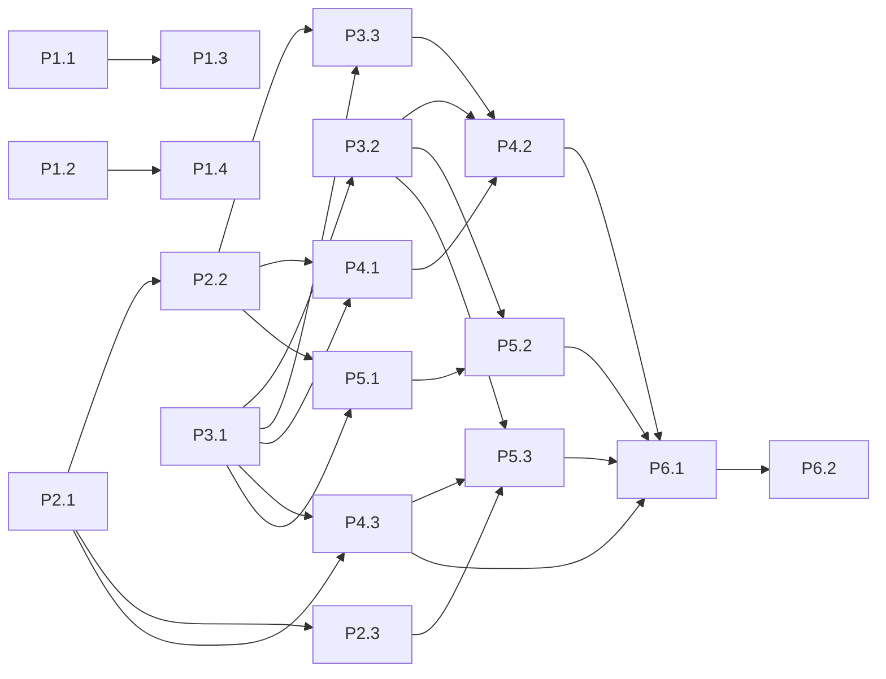
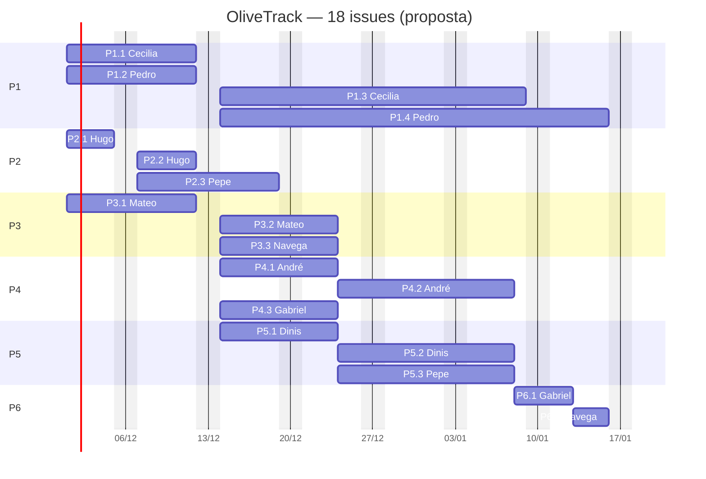

# OliveTrack — Plano de Implementação por Fases

Documento de trabalho derivado do `docs/report.pdf` (versão de 21 de novembro de 2026) e da divisão
de fases da equipa. Serve de base para os **18 issues** no GitHub (2 por membro) e para o Gantt.

---

## 1. Como usar este documento

- Cada issue tem um **ID estável** (`P<fase>.<n>`), um responsável, datas, dependências e uma lista de
  tarefas com critérios de aceitação, pronta a copiar para o GitHub.
- As **datas são uma proposta** com entrega e defesa até **15 de janeiro de 2027**. Só os fins de
  semana são excluídos.
- A divisão de fases por pares vem da equipa. A repartição **dentro de cada par**, os issues de
  gestão (P1) e as datas são uma proposta a confirmar.
- Referências a páginas e requisitos (`UC-xx`, `FR-xxx`, `BR-xxx`, `p. N`) apontam para o relatório.
- Nenhum issue está concluído.

**Labels sugeridas:** `fase:P1`…`fase:P6`, `plano`.

---

## 2. Visão geral das fases

| Fase | Nome | Par | Issues | Período proposto |
|---|---|---|---|---|
| P1 | Documentação de gestão do projeto | Cecilia e Pedro | 4 | 01/12 – 15/01 |
| P2 | Ambiente, fundação, contratos e cálculos partilhados | Hugo e Pepe | 3 | 01/12 – 18/12 |
| P3 | Base de dados, dados de demonstração e dados locais offline | Mateo e Navega | 3 | 01/12 – 23/12 |
| P4 | API, sincronização, acessos, ficheiros, implantação e backups | André e Gabriel | 3 | 14/12 – 07/01 |
| P5 | Funcionalidades agrícolas e ecrãs | Pepe e Dinis | 3 | 14/12 – 07/01 |
| P6 | Integração, testes, validação e entrega final | Gabriel e Navega | 2 | 08/01 – 15/01 |

---

## 3. Divisão por membro

| Membro | Primeiro issue | Segundo issue |
|---|---|---|
| Cecilia | P1.1 Âmbito, requisitos e expectativas do cliente | P1.3 Riscos, responsabilidades e inventário de uso de IA |
| Pedro | P1.2 Estimativas, calendário e Gantt | P1.4 Acompanhamento do progresso e dossiê final de gestão |
| Hugo | P2.1 Ambiente de desenvolvimento e integração contínua | P2.2 Fundação do projeto: módulos da API e shell da PWA |
| Pepe | P2.3 Contratos e cálculos partilhados | P5.3 Documentos e indicadores |
| Mateo | P3.1 Modelo de dados e migrações principais | P3.2 Migrações restantes e integridade dos dados |
| Navega | P3.3 Dados de demonstração e armazenamento local offline | P6.2 Validação com o cliente, handover e entrega final |
| André | P4.1 Contas e controlo de acessos | P4.2 Fundação da API de sincronização |
| Gabriel | P4.3 Ficheiros protegidos, implantação e backups | P6.1 Integração e testes |
| Dinis | P5.1 Propriedades, campanhas, trabalhadores e planeamento | P5.2 Registos de trabalho e entregas |

---

## 4. Fase P1 — Documentação de gestão do projeto

**Par:** Cecilia e Pedro.

### P1.1 — Âmbito, requisitos e expectativas do cliente

- **Responsável:** Cecilia
- **Datas:** 01/12/2026 → 11/12/2026 (9 dias úteis)
- **Depende de:** —
- **Objetivo:** Fixar a baseline de âmbito e o modo de a alterar e validar com o cliente.

**Tarefas:**

- [ ] **Statement of Work e âmbito** — rever âmbito incluído e excluído e a entrega única. *Aceitação:* versão revista pela equipa, com data.
- [ ] **Controlo de alterações** — registar como se propõem, aprovam e propagam alterações a requisitos. *Aceitação:* procedimento escrito e aplicado à primeira alteração.
- [ ] **Validação com o cliente** — pontos de controlo com o intermediário sobre âmbito, calendário e qualidade. *Aceitação:* perguntas, respostas e pressupostos registados.

**Refs:** Secções 3, 3.6, 10.5 e 11.2 do relatório.

### P1.2 — Estimativas, calendário e Gantt

- **Responsável:** Pedro
- **Datas:** 01/12/2026 → 11/12/2026 (9 dias úteis)
- **Depende de:** —
- **Objetivo:** Reconciliar esforço e capacidade e aprovar o calendário até 15 de janeiro.

**Tarefas:**

- [ ] **Estimativas e capacidade** — atualizar o workbook e confirmar a disponibilidade de cada membro. *Aceitação:* esforço restante e capacidade registados por pessoa.
- [ ] **Issues e Gantt** — publicar os 18 issues, responsáveis, dependências e datas no quadro. *Aceitação:* vista Roadmap revista pela equipa.
- [ ] **Folha de horas** — definir como se registam horas reais e esforço de reuniões. *Aceitação:* primeira semana registada por todos.

**Refs:** Secções 10.6 e 11.3 (Q-PM-01).

### P1.3 — Riscos, responsabilidades e inventário de uso de IA

- **Responsável:** Cecilia
- **Datas:** 14/12/2026 → 08/01/2027 (20 dias úteis)
- **Depende de:** P1.1
- **Objetivo:** Manter o registo de riscos vivo e fechar as responsabilidades em aberto.

**Tarefas:**

- [ ] **Registo de riscos** — rever semanalmente os prioritários, com dono, estado, ação e prazo. *Aceitação:* revisões datadas com evidência.
- [ ] **Responsáveis e substitutos** — nomear donos de coordenação, risco, testes e operação. *Aceitação:* cada área com um nome e um substituto.
- [ ] **Inventário de IA** — registar ferramentas, tarefas e quem reviu cada contributo. *Aceitação:* inventário completo para toda a equipa.

**Refs:** Secções 10.3–10.5 e 11.3 (Q-PM-02).

### P1.4 — Acompanhamento do progresso e dossiê final de gestão

- **Responsável:** Pedro
- **Datas:** 14/12/2026 → 15/01/2027 (25 dias úteis)
- **Depende de:** P1.2
- **Objetivo:** Acompanhar planeado contra real e reunir a documentação de gestão para a entrega.

**Tarefas:**

- [ ] **Acompanhamento semanal** — comparar datas planeadas e reais, horas e esforço restante. *Aceitação:* um registo por semana, com desvios e decisões.
- [ ] **Dossiê final** — reunir plano, estimativas, horas, riscos, decisões e lições aprendidas. *Aceitação:* pasta partilhada completa antes da defesa.

**Refs:** Secções 1.4 e 10.6.

---

## 5. Fase P2 — Ambiente, fundação, contratos e cálculos partilhados

**Par:** Hugo e Pepe.

### P2.1 — Ambiente de desenvolvimento e integração contínua

- **Responsável:** Hugo
- **Datas:** 01/12/2026 → 04/12/2026 (4 dias úteis)
- **Depende de:** —
- **Objetivo:** Monorepo reprodutível, com CI e ambiente local.

**Tarefas:**

- [ ] **Consolidar workspaces e `@app/shared`** — `package.json` raiz com workspaces; build de `shared` a preceder os consumidores; scripts agregados (`dev`, `build`, `lint`, `test`). *Aceitação:* `npm install && npm run build` na raiz termina sem erros num clone limpo.
- [ ] **Fixar dependências e política de código gerado** — versões exatas no `package.json`; revisão de código gerado (Prisma, Workbox). *Aceitação:* nenhuma dependência com `^` ou `~`; PR de revisão de artefactos gerados.
- [ ] **Pipeline GitHub Actions** — workflow com serviço PostgreSQL; cache de npm; jobs separados por workspace. *Aceitação:* pipeline verde num PR de teste e bloqueante para merge na `main`.
- [ ] **Empacotamento Docker e ambiente local** — `docker-compose.yml` com Postgres 16 (já existe); Dockerfile do backend; `.env.example` documentado. *Aceitação:* `npm run db:up && npm run db:migrate && npm run dev` sobe o sistema completo.

**Refs:** p. 114; README do repositório · p. 114 · p. 114–115 · p. 114–115.

### P2.2 — Fundação do projeto: módulos da API e shell da PWA

- **Responsável:** Hugo
- **Datas:** 07/12/2026 → 11/12/2026 (5 dias úteis)
- **Depende de:** P2.1
- **Objetivo:** Estrutura base do backend e do frontend sobre a qual assentam as funcionalidades.

**Tarefas:**

- [ ] **Módulos NestJS por responsabilidade de domínio** — `auth`, `workspace`, `property`, `campaign`, `worker`, `planning`, `attendance`, `delivery`, `document`, `indicator`, `sync`; prefixo global `/api` mantido. *Aceitação:* cada módulo tem controller, service e testes; `/api/health` mantém-se.
- [ ] **Shell da PWA e navegação autenticada** — rotas protegidas; manifest e service worker já gerados por `vite-plugin-pwa`; estados de carregamento e erro. *Aceitação:* instalação como PWA em telemóvel e desktop sem erros de consola.

**Refs:** p. 110; Secção 8.2.3 · p. 109; AOC-03.

### P2.3 — Contratos e cálculos partilhados

- **Responsável:** Pepe
- **Datas:** 07/12/2026 → 18/12/2026 (10 dias úteis)
- **Depende de:** P2.1
- **Objetivo:** Um único contrato de dados e uma única implementação das regras de cálculo.

**Tarefas:**

- [ ] **Camada de validação com Zod partilhado** — schemas em `@app/shared`; rejeição recuperável de formatos não suportados; versão de payload enviada com pedidos de sync. *Aceitação:* payload inválido devolve erro tipado e não cria registo.
- [ ] **Regras de cálculo partilhadas** — regras em `@app/shared`; servidor como autoridade (REL-03); precisão preservada. *Aceitação:* cliente e servidor produzem o mesmo resultado para os mesmos dados.

**Refs:** p. 111, 115; REL-07; Q-NFR-02 · p. 111; Secção 6.4; REL-03.

---

## 6. Fase P3 — Base de dados, dados de demonstração e dados locais offline

**Par:** Mateo e Navega.

### P3.1 — Modelo de dados e migrações principais

- **Responsável:** Mateo
- **Datas:** 01/12/2026 → 11/12/2026 (9 dias úteis)
- **Depende de:** —
- **Objetivo:** Modelo validado e tabelas de identidade, propriedades, campanhas e trabalhadores.

**Tarefas:**

- [ ] **Fechar o modelo conceptual de 33 entidades** — revisão das sete famílias de 9.1.1 a 9.1.7; confirmação de `WorkerAvailability` como associação de acesso. *Aceitação:* diagrama ER revisto e assinado pela equipa, sem entidades em aberto.
- [ ] **Escrever o modelo lógico completo** — convenções de UUID, `workspace_id`, revision counter, `timestamptz` vs `date`. *Aceitação:* todas as tabelas de 9.2 mapeadas no `schema.prisma` com campos e tipos.
- [ ] **DDL da família identidade/scope** — UUID como PK; chave composta `membership/operation/property` em `AccessGrant`; índice único `membership/worker` em `WorkerAvailability`. *Aceitação:* migração aplica e reverte sem erro; constraints verificadas por teste.
- [ ] **DDL de propriedades, parcelas e campanhas** — unicidade de área com tratamento explícito de `NULL` (parcela opcional = âmbito de propriedade inteira); estados `planned`, `in_progress`, `closed`. *Aceitação:* índices parciais/uniqueness com `NULL` testados; ciclo de vida validado.
- [ ] **DDL de trabalhadores e planeamento** — identificação oficial como `text` preservando zeros à esquerda; índice não único `workspace/type/country/número normalizado`; sobreposições de mesmo trabalhador validadas separadamente para planeado e real. *Aceitação:* exclusão/serialização de sobreposições comprovada por teste de concorrência.

**Refs:** p. 117–124; Secção 9.1 · p. 124–128; Secção 9.2 · p. 117–118, 133–134; Secção 9.1.1 · p. 118, 133; Secção 9.1.2 · p. 118–119, 133; Secção 9.1.4.

### P3.2 — Migrações restantes e integridade dos dados

- **Responsável:** Mateo
- **Datas:** 14/12/2026 → 23/12/2026 (8 dias úteis)
- **Depende de:** P3.1
- **Objetivo:** Tabelas de entregas, documentos e sincronização, com restrições e ciclo de vida.

**Tarefas:**

- [ ] **DDL de entregas, cargas e resultados** — um único ticket e uma única análise por entrega; três alvos de anexo mutuamente exclusivos; `numeric` para kg, áreas, rendimento e montantes (2 casas decimais em dinheiro). *Aceitação:* constraints de exclusividade e precisão verificadas por teste.
- [ ] **DDL de documentos, assinaturas e ficheiros** — um único `DocumentVersion` corrente por documento; substituição remove assinaturas e renditions antigas de forma consistente; digest de integridade (SEC-08); limite de upload 10 000 000 bytes. *Aceitação:* substituição current-only testada; digest verificado antes da associação.
- [ ] **Tabelas técnicas de sincronização e segurança** — retenção de 90 dias para outcomes e marcadores; 30 dias de compatibilidade de payload; cursor durável. *Aceitação:* políticas de retenção expressas em migração e testadas por job de limpeza.
- [ ] **Restrições transacionais e índices essenciais** — contagem mínima de filhos; serialização de reservas de execução por propriedade e parcelas; unicidade parcial de Owner e de propriedade/parcela. *Aceitação:* testes de concorrência demonstram que leitura-depois-inserção não passa.
- [ ] **Ciclo de vida e histórico** — sem histórico campo-a-campo; marcador de eliminação é facto técnico, não histórico; snapshots de template preservados. *Aceitação:* cenário de correção e cenário de eliminação produzem registos distintos.

**Refs:** p. 120–122, 133; Secção 9.1.5 · p. 122–123, 133; Secção 9.1.6–9.1.7 · p. 113, 133–134; Secções 8.4.2 e 9.7 · p. 129–130, 133; Secção 9.4 · p. 131; Secção 9.5.

### P3.3 — Dados de demonstração e armazenamento local offline

- **Responsável:** Navega
- **Datas:** 14/12/2026 → 23/12/2026 (8 dias úteis)
- **Depende de:** P2.2, P3.1
- **Objetivo:** Dados sintéticos e estruturas locais para trabalhar sem ligação.

**Tarefas:**

- [ ] **Dados de demonstração sintéticos** — dataset sintético ou anonimizado; nenhum dado real até a base de tratamento estar estabelecida (Q-NFR-03). *Aceitação:* verificação de que o dataset não contém identificadores pessoais reais.
- [ ] **Esquema Dexie e gravação atómica** — tabelas `outbox`, `meta`, subconjuntos preparados; confirmação local apresentada separadamente da aceitação. *Aceitação:* interrupção simulada a meio da gravação não deixa proposta sem outbox.
- [ ] **Subconjuntos preparados e limpeza** — manifesto de ficheiros preparados; limpeza que não revive versões eliminadas; remoção de dados inacessíveis sem submissão por outra conta. *Aceitação:* redução de acesso remove dados preparados e mantém propostas protegidas.

**Refs:** p. 114; Secção 7.4; Q-NFR-03 · p. 109, 112; FR-034; AOC-03 · p. 113, 131–132; Secção 9.6.

---

## 7. Fase P4 — API, sincronização, acessos, ficheiros, implantação e backups

**Par:** André e Gabriel.

### P4.1 — Contas e controlo de acessos

- **Responsável:** André
- **Datas:** 14/12/2026 → 23/12/2026 (8 dias úteis)
- **Depende de:** P2.2, P3.1
- **Objetivo:** Registo, sessões, convites, permissões e expiração offline.

**Tarefas:**

- [ ] **Registo de Owner e verificação de email** — hash de password com salt; desafio de verificação que não altera o `User.id` nem a propriedade; criação de workspace com timezone de negócio validado. *Aceitação:* registo + verificação criam exatamente um workspace por conta.
- [ ] **Login, logout e recuperação de acesso** — sessões com verificador; logout que bloqueia acesso local mas preserva trabalho pendente em armazenamento isolado por conta; recuperação e atualização de credenciais. *Aceitação:* logout e reautenticação recuperam propostas pendentes sem perda.
- [ ] **Convites de gestor** — `ManagerInvitation` com configuração validada por schema; aceitação exige a conta verificada destinatária; âmbito validado na criação e na aceitação, incluindo propriedade revogada ou arquivada. *Aceitação:* convite para conta errada é rejeitado; convite expirado não concede acesso.
- [ ] **Grants, permissões ajustáveis e revogação** — scopes de parcelas e campanhas atuais/futuras; revogação preserva referências de autor/iniciador; sem transferência de propriedade. *Aceitação:* matriz de permissões da Secção 2.4 coberta por testes por operação.
- [ ] **Gate de expiração offline (BR-002)** — instante da última validação bem-sucedida e expiração; uso de cache não renova; proteção contra recuo simples do relógio (mecanismo de tempo confiável em aberto, Q-DOC-07). *Aceitação:* dispositivo com contexto expirado não cria operações novas e preserva propostas recuperáveis até revalidação.

**Refs:** p. 117; UC-01; FR-001–FR-003 · p. 109, 113; UC-02, UC-03; FR-004–FR-008 · p. 117, 134; UC-04 · p. 117, 134; Secção 2.4; SEC-01–SEC-04 · p. 113–114; BR-002; AOC-02.

### P4.2 — Fundação da API de sincronização

- **Responsável:** André
- **Datas:** 24/12/2026 → 07/01/2027 (11 dias úteis)
- **Depende de:** P3.2, P3.3, P4.1
- **Objetivo:** Enviar, aceitar e recuperar propostas offline sem perda nem duplicação.

**Tarefas:**

- [ ] **Identidade de operação e dependências ordenadas** — UUID gerado no cliente consistente entre dispositivos e servidor; submissão de dependências primeiro (entrega antes do ticket, versão antes da assinatura). *Aceitação:* proposta com dependência pendente não é aceite fora de ordem.
- [ ] **Máquina de estados do outbox** — pending, submitting, accepted, rejected, conflict; contadores de tentativa. *Aceitação:* cada transição tem teste e nenhum estado terminal perde o payload.
- [ ] **Endpoint de push idempotente** — commit da mudança e do resultado de idempotência em conjunto; devolver identidades e revisões afetadas; ID reutilizado com conteúdo diferente não é o mesmo retry. *Aceitação:* reenvio do mesmo pedido não duplica efeitos de negócio.
- [ ] **Conflitos por revisão base** — comparação de valores aceites vs. proposta; manter aceite ou reenviar correção revista; preservar proposta rejeitada de forma recuperável. *Aceitação:* edição concorrente gera conflito e nunca sobrescrita silenciosa.
- [ ] **Feed de alterações com cursor durável** — aplicação consistente de mudanças, marcadores de eliminação e avanço de cursor; refresh autorizado fora da janela de retenção. *Aceitação:* cursor retomado após reinício não perde nem duplica alterações.
- [ ] **Estado incerto e retry seguro** — verificação de estado da operação antes de reenviar; backoff. *Aceitação:* timeout simulado resolve por consulta de estado, sem duplicar.
- [ ] **Recuperação de revisão do Owner** — preservar origem e revisor; aceitação do Owner fornece autoridade nova; conta de origem autentica apenas para submissão restrita. *Aceitação:* gestor revogado não recupera acesso normal ao workspace.
- [ ] **Compatibilidade de cliente e payload** — versão de cliente/payload no pedido; rejeição recuperável de formatos não suportados; migração e rollback revistos. *Aceitação:* cliente de versão anterior sincroniza dentro dos 30 dias previstos.

**Refs:** p. 112; Secção 8.4.1 · p. 112; Secção 6.2.5 · p. 113; Secção 8.4.2; REL-01, REL-02 · p. 113; REL-02; Secção 8.6 · p. 113; Secção 8.4.2 · p. 113; REL-01 · p. 113–114; REL-08; Q-NFR-06 · p. 115; REL-07; Q-NFR-02.

### P4.3 — Ficheiros protegidos, implantação e backups

- **Responsável:** Gabriel
- **Datas:** 14/12/2026 → 23/12/2026 (8 dias úteis)
- **Depende de:** P2.1, P3.1
- **Objetivo:** Armazenamento privado de ficheiros, procedimento de implantação e restauro ensaiado.

**Tarefas:**

- [ ] **Object storage privado e metadados** — `StoredFile` com validação de formato e tamanho no servidor; limite de 10 MB; acesso por grant, nunca por link partilhado. *Aceitação:* upload acima do limite e formato não aceite são rejeitados no servidor.
- [ ] **Digest de integridade e upload recuperável** — digest por fonte aceite; estado de upload separado da aceitação do registo; objeto indisponível nunca aparece como armazenado. *Aceitação:* corrupção simulada impede associação; retry retoma o upload.
- [ ] **Build de produção e migrações de release** — build de `shared`, `backend` e `frontend`; migrações aplicadas por procedimento revisto; rollback documentado. *Aceitação:* implantação a partir de clone limpo reproduz o ambiente de testes.
- [ ] **Ensaio de restauro de base de dados e ficheiros** — backup diário e retenção de 14 dias; RPO/RTO definidos; ensaio documentado. *Aceitação:* restauro completo executado e cronometrado, com registo de data.

**Refs:** p. 123, 133; SEC-08 · p. 113, 133; SEC-08 · p. 114–115; Secção 8.5.2 · p. 115; Secção 7.6; Q-VERIFY-01.

---

## 8. Fase P5 — Funcionalidades agrícolas e ecrãs

**Par:** Pepe e Dinis.

### P5.1 — Propriedades, campanhas, trabalhadores e planeamento

- **Responsável:** Dinis
- **Datas:** 14/12/2026 → 23/12/2026 (8 dias úteis)
- **Depende de:** P2.2, P3.1
- **Objetivo:** API e ecrãs de organização do trabalho.

**Tarefas:**

- [ ] **Propriedades, parcelas e campanhas** — CRUD de propriedades e parcelas opcionais; criação, cobertura, fecho e reabertura de campanha; datas planeadas e reais. *Aceitação:* campanha fechada rejeita execução nova e permite correção autorizada.
- [ ] **Registos de trabalhadores** — criação offline autorizada no mesmo dia com UUID estável gerado no cliente; administração de perfis existentes permanece online. *Aceitação:* trabalhador criado offline é aceite sem duplicar identidade.
- [ ] **Planeamento e consulta de horários** — planos diários e multi-dia, reutilização, consulta de horários preparados. *Aceitação:* plano não conta como trabalho real em nenhum indicador.
- [ ] **Camada de dados com TanStack Query** — chaves de query por workspace; invalidação após aceitação central. *Aceitação:* nenhuma leitura usa dados de outro workspace em cache.

**Refs:** p. 118; UC-05, UC-06; FR-013–FR-020 · p. 112, 118; UC-07; FR-021–FR-024 · p. 119; UC-08, UC-09; FR-025–FR-030 · p. 109.

### P5.2 — Registos de trabalho e entregas

- **Responsável:** Dinis
- **Datas:** 24/12/2026 → 07/01/2027 (11 dias úteis)
- **Depende de:** P3.2, P5.1
- **Objetivo:** Assiduidade, trabalho real, entregas e pesagens, utilizáveis no campo.

**Tarefas:**

- [ ] **Assiduidade e períodos de trabalho real** — arranque explícito de campanha `planned → in_progress` validado atomicamente; períodos, pausas e tarefas; correções com autor e revisão. *Aceitação:* dois arranques concorrentes na mesma área não são ambos aceites.
- [ ] **Transporte e entregas** — entrega antes do ticket; estado de entrega e elegibilidade *Delivered* não cancelada. *Aceitação:* entrega cancelada deixa de contribuir para totais.
- [ ] **Pesagem, análises e valores da cooperativa** — um ticket e uma análise por entrega, registáveis mais tarde; ajustes de pesagem; valores reportados pela cooperativa com proveniência. *Aceitação:* segundo ticket na mesma entrega é rejeitado; valor reportado mantém origem.
- [ ] **Ecrãs de execução offline** — indicação explícita de estado local vs. aceite; feedback de recuperação (AOC-06); usabilidade em telemóvel e tablet. *Aceitação:* fluxo completo de campo executado em modo avião.

**Refs:** p. 112–113, 119; UC-10, UC-11; FR-031–FR-036; BR-010–BR-020 · p. 120; UC-15; FR-037–FR-041; BR-038 · p. 120–122; UC-16–UC-18; FR-042–FR-050 · p. 109, 115; AOC-06; Secção 7.2.

### P5.3 — Documentos e indicadores

- **Responsável:** Pepe
- **Datas:** 24/12/2026 → 07/01/2027 (11 dias úteis)
- **Depende de:** P2.3, P3.2, P4.3
- **Objetivo:** Documentos de trabalhador, assinatura, PDFs e indicadores de campanha.

**Tarefas:**

- [ ] **Consulta e upload de documentos** — upload online obrigatório; substituição current-only; retenção de versões substituídas conforme política. *Aceitação:* nova versão torna-se corrente só quando a fonte está disponível.
- [ ] **Revisão e assinatura** — assinatura offline apenas sobre fonte individual já aceite; aprovação não sobrepõe elegibilidade; renditions por trabalhador/versão com chave única. *Aceitação:* assinatura sobre fonte antiga é invalidada após substituição.
- [ ] **Geração de PDFs** — snapshots de template; geração online; PDF offline com âmbito, frescura, informação em falta e dados pendentes registados. *Aceitação:* PDF gerado contém âmbito, hora de geração e estado de pendências.
- [ ] **Indicadores de campanha** — apenas entregas *Delivered* e não canceladas contribuem (BR-038); totais monetários correntes e alocação. *Aceitação:* entrega cancelada ou não entregue não altera totais.
- [ ] **Indicadores provisórios locais** — criar uma vez, substituir em update, remover contribuição em remoção local; divulgar âmbito em falta e última sincronização. *Aceitação:* valor provisório nunca é apresentado como total central.
- [ ] **Snapshots de relatório** — snapshot com âmbito e instante; sem histórico campo-a-campo. *Aceitação:* snapshot antigo não muda quando os dados centrais mudam.

**Refs:** p. 122; UC-12, UC-13; FR-051–FR-056 · p. 122–123; UC-14; FR-057–FR-060; BR-026 · p. 114, 122; UC-20; FR-061–FR-064 · p. 120–122; UC-19; BR-038; Secção 6.4.3 · p. 114; Secção 8.4.4 · p. 131; Secção 9.5.

---

## 9. Fase P6 — Integração, testes, validação e entrega final

**Par:** Gabriel e Navega.

### P6.1 — Integração e testes

- **Responsável:** Gabriel
- **Datas:** 08/01/2027 → 12/01/2027 (3 dias úteis)
- **Depende de:** P4.2, P4.3, P5.2, P5.3
- **Objetivo:** Juntar as partes e verificar regras, sincronização, concorrência e desempenho.

**Tarefas:**

- [ ] **Testes unitários e de integração por módulo** — Vitest no backend e frontend; base de dados de teste efémera. *Aceitação:* relatório de cobertura por módulo anexado à issue.
- [ ] **Testes de sincronização e concorrência** — cenários reproduzíveis com dois dispositivos simulados. *Aceitação:* cada cenário de 8.5.3 tem resultado registado, não presumido.
- [ ] **Medições de desempenho** — sondas sintéticas que não exponham dados de trabalhadores nem desativem entrada offline. *Aceitação:* tabela de medições com dispositivo, browser, versão e data.

**Refs:** p. 115; Secção 11.1 · p. 115; Secção 8.5.3 · p. 115; Secção 7.1; Q-VERIFY-01.

### P6.2 — Validação com o cliente, handover e entrega final

- **Responsável:** Navega
- **Datas:** 13/01/2027 → 15/01/2027 (3 dias úteis)
- **Depende de:** P6.1
- **Objetivo:** Validar com o cliente, entregar e defender o projeto.

**Tarefas:**

- [ ] **Evidência de dispositivos e usabilidade** — execução dos fluxos de campo preparados; feedback de recuperação. *Aceitação:* lista de dispositivos e resultados por fluxo, sem valores inventados.
- [ ] **Acessibilidade e usabilidade** — contraste, foco, tamanhos de alvo, textos de erro acionáveis. *Aceitação:* verificação por teclado e leitor de ecrã nos ecrãs principais.
- [ ] **Relatório final e evidência de aceitação** — tabela critério → evidência → revisor → data; lacunas declaradas. *Aceitação:* nenhum critério marcado como aprovado sem evidência executada.
- [ ] **Apresentação e defesa** — guião do fluxo (preparar → planear → confirmar → registar → consultar); ambiente de demonstração estável. *Aceitação:* demonstração executada sem depender de conectividade não prevista.

**Refs:** p. 115, 141; AOC-06; Q-VERIFY-01 · p. 109; Secção 7.2; AOC-01–AOC-06 · p. 141, 146; ToS-1, ToS-3 · p. 12, 146; Secção 3.3.

---

## 10. Grafo de dependências

---

## 11. Gantt chart

---

## 12. Tabela de issues para importação

«Estimativa original» é a soma das durações do plano detalhado anterior, antes de qualquer
compressão. Os issues de gestão (P1) não tinham estimativa.

| ID | Responsável | Título | Depende de | Início | Fim | Dias úteis | Estimativa original |
|---|---|---|---|---|---|---|---|
| P1.1 | Cecilia | Âmbito, requisitos e expectativas do cliente | — | 2026-12-01 | 2026-12-11 | 9 | — |
| P1.2 | Pedro | Estimativas, calendário e Gantt | — | 2026-12-01 | 2026-12-11 | 9 | — |
| P1.3 | Cecilia | Riscos, responsabilidades e inventário de uso de IA | P1.1 | 2026-12-14 | 2027-01-08 | 20 | — |
| P1.4 | Pedro | Acompanhamento do progresso e dossiê final de gestão | P1.2 | 2026-12-14 | 2027-01-15 | 25 | — |
| P2.1 | Hugo | Ambiente de desenvolvimento e integração contínua | — | 2026-12-01 | 2026-12-04 | 4 | 10 d |
| P2.2 | Hugo | Fundação do projeto: módulos da API e shell da PWA | P2.1 | 2026-12-07 | 2026-12-11 | 5 | 9 d |
| P2.3 | Pepe | Contratos e cálculos partilhados | P2.1 | 2026-12-07 | 2026-12-18 | 10 | 8 d |
| P3.1 | Mateo | Modelo de dados e migrações principais | — | 2026-12-01 | 2026-12-11 | 9 | 23 d |
| P3.2 | Mateo | Migrações restantes e integridade dos dados | P3.1 | 2026-12-14 | 2026-12-23 | 8 | 21 d |
| P3.3 | Navega | Dados de demonstração e armazenamento local offline | P2.2, P3.1 | 2026-12-14 | 2026-12-23 | 8 | 11 d |
| P4.1 | André | Contas e controlo de acessos | P2.2, P3.1 | 2026-12-14 | 2026-12-23 | 8 | 20 d |
| P4.2 | André | Fundação da API de sincronização | P3.2, P3.3, P4.1 | 2026-12-24 | 2027-01-07 | 11 | 35 d |
| P4.3 | Gabriel | Ficheiros protegidos, implantação e backups | P2.1, P3.1 | 2026-12-14 | 2026-12-23 | 8 | 16 d |
| P5.1 | Dinis | Propriedades, campanhas, trabalhadores e planeamento | P2.2, P3.1 | 2026-12-14 | 2026-12-23 | 8 | 18 d |
| P5.2 | Dinis | Registos de trabalho e entregas | P3.2, P5.1 | 2026-12-24 | 2027-01-07 | 11 | 22 d |
| P5.3 | Pepe | Documentos e indicadores | P2.3, P3.2, P4.3 | 2026-12-24 | 2027-01-07 | 11 | 28 d |
| P6.1 | Gabriel | Integração e testes | P4.2, P4.3, P5.2, P5.3 | 2027-01-08 | 2027-01-12 | 3 | 16 d |
| P6.2 | Navega | Validação com o cliente, handover e entrega final | P6.1 | 2027-01-13 | 2027-01-15 | 3 | 15 d |

---

## 13. Pressupostos e lacunas

| Lacuna | Origem | Efeito no plano |
|---|---|---|
| Entrega e defesa até 15/01/2027 (indicado pela equipa; não consta do relatório) | Q-PM-01 | Calendário muito comprimido |
| Capacidade de cada membro não confirmada | Q-PM-01 | A carga por pessoa é muito desigual (ver secção 12) |
| Feriados (1, 8 e 25/12, 1/01) e férias de Natal contam como dias de trabalho | — | Datas otimistas |
| P4.3 prepara a implantação antes de existirem as funcionalidades | Divisão de fases | A versão final tem de ser novamente implantada em P6 |
| O relatório indica Pepe e Mateo no contributo de riscos; a divisão atribui a gestão a Cecilia e Pedro | p. 136 | Confirmar quem fica com P1.3 |
| Mecanismo de proteção local e tempo confiável em aberto | Q-DOC-07 | P3.3 e P4.1 com validação pendente |
| Hosting, custos e responsável operacional em aberto | Q-ARCH-02 | P4.3 sem alvo definitivo |
| Base legal para dados pessoais reais não estabelecida | Q-NFR-03 | P3.3 usa apenas dados sintéticos |
